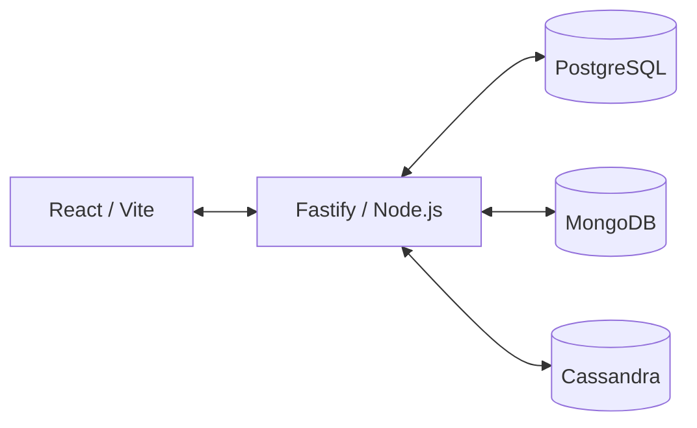

# AutoDealer Analytics

Sistema acadêmico de gestão de concessionária desenvolvido na disciplina de **Tuning e Performance de Dados**, com **persistência poliglota** em PostgreSQL, MongoDB e Apache Cassandra.

> **Status:** versão acadêmica funcional para demonstração local. Não utilizar publicamente em produção: as rotas de escrita de demonstração não possuem autenticação/autorização reais.

## Objetivo e escolha das tecnologias

A aplicação permite gerenciar estoque, clientes, anúncios, leads, agendamentos, vendas, vistorias e favoritos. Cada tecnologia foi escolhida conforme o padrão de uso dos dados.

| Camada | Tecnologia | Justificativa |
|---|---|---|
| Frontend | React, TypeScript, Vite, Tailwind CSS | Interface administrativa e catálogo público |
| Backend | Node.js, Fastify, TypeScript | API HTTP modular conectada aos três bancos |
| Relacional | PostgreSQL 17 | Integridade referencial e transações comerciais |
| Documental | MongoDB 7.0 | Auditoria com deltas e vistorias com checklist flexível |
| Wide-column | Apache Cassandra 5.0 | Eventos e favoritos com consultas orientadas a partições |
| Infraestrutura | Docker Compose | Execução local reproduzível dos serviços de banco |



### Persistência e consistência

- **PostgreSQL:** fonte transacional principal; operações comerciais e relacionamentos entre veículos, anúncios, clientes, leads, agendamentos e vendas.
- **MongoDB:** coleção `audit_events` para histórico de mudanças e coleção separada de vistorias. A auditoria é encaminhada pelo padrão **outbox transacional**, permitindo reprocessamento após indisponibilidade temporária do MongoDB. Vistorias aprovadas são preservadas para consulta.
- **Cassandra:** tabelas denormalizadas de telemetria (por anúncio, veículo, usuário, tipo e período) e tabela de favoritos por usuário. O laboratório local utiliza **RF=1**; não há tolerância à queda de um nó Cassandra nessa configuração.

## Funcionalidades

- Cadastro e consulta de clientes; edição e exclusão quando permitidas pelos vínculos transacionais.
- Cadastro de veículos e gestão do estoque; retirada lógica de unidades, preservando histórico.
- Criação de anúncios em rascunho, publicação, pausa e encerramento; seleção de anúncios publicados para a seção de **destaques reais** do site.
- Catálogo público, visualização de veículos e favoritos gerenciáveis pelo usuário de demonstração.
- Vistorias documentais com checklist, histórico, edição de rascunhos e aprovação.
- Gestão de leads, agendamentos e vendas, com atualização de status e auditoria.
- Registros de telemetria e consultas no Cassandra; experimentos de índices e benchmarks.

**Importante:** a exclusão de veículos e anúncios é lógica quando necessária para preservar referências e auditoria; ela não representa necessariamente `DELETE` físico no PostgreSQL.

## Pré-requisitos

- Git, Node.js/npm e Docker Desktop com Docker Compose.
- Windows PowerShell (os scripts `.ps1` foram preparados para Windows); Python 3.12 para os scripts de integração `apply-*.py` caso precise reaplicar patches (o código versionado já deve conter essas alterações).
- Portas locais disponíveis: `5433` (PostgreSQL), `27017` (MongoDB), `9042` (Cassandra), `3333` (API) e `5173` (site).
- Memória suficiente para executar os três bancos, especialmente o Cassandra.

## Instalação em computador novo — bancos vazios

> **Execute as etapas de inicialização SQL/CQL/MongoDB somente em uma instalação nova, com volumes vazios.** O script `database/postgresql/schema.sql` não deve ser reaplicado indiscriminadamente em um banco já preenchido. **Não execute `docker compose down -v`** para tentar reiniciar os dados de uma máquina de demonstração.

### 1. Clonar e configurar as variáveis

Após o merge da versão acadêmica na `main`:

```powershell
git clone https://github.com/Omestredodev/autodealer-analytics.git
cd autodealer-analytics
Copy-Item .\backend\.env.example .\backend\.env
```

Até ocorrer o merge, teste a branch `feat/crud-poliglota`, por exemplo usando `git clone --branch feat/crud-poliglota`.

Crie **`.env` na raiz do repositório** com uma senha PostgreSQL definida por você:

```dotenv
POSTGRES_PASSWORD=SUA_SENHA_LOCAL
```

Ajuste **`backend/.env`** conforme `backend/.env.example`. Para o PostgreSQL do Compose, os valores locais relevantes são:

```dotenv
PORT=3333
PGHOST=127.0.0.1
PGPORT=5433
PGDATABASE=autodealer_analytics
PGUSER=postgres
PGPASSWORD=SUA_SENHA_LOCAL
MONGO_URI=mongodb://127.0.0.1:27017
MONGO_DB=autodealer
CASSANDRA_CONTACT_POINTS=127.0.0.1
CASSANDRA_LOCAL_DC=datacenter1
CASSANDRA_KEYSPACE=autodealer
CRUD_DEMO_ENABLED=true
```

Utilize a **mesma senha** de PostgreSQL nos dois arquivos. `CRUD_DEMO_ENABLED=true` habilita operações de escrita **somente para demonstração local**. Não publique `.env` nem credenciais no Git. Verifique que ambos estejam ignorados com `git check-ignore .env backend/.env`.

### 2. Iniciar os três serviços

```powershell
docker compose up -d
docker compose ps
```

Aguarde o PostgreSQL ficar `healthy` e o Cassandra estar pronto para conexões CQL. Inicialização inicial do Cassandra pode ser mais lenta.

### 3. Criar e popular PostgreSQL — executar uma única vez

```powershell
docker cp .\database\postgresql\schema.sql autodealer-postgres:/tmp/schema.sql
docker exec autodealer-postgres psql -X -v ON_ERROR_STOP=1 -U postgres -d autodealer_analytics -f /tmp/schema.sql

docker cp .\database\postgresql\seed.sql autodealer-postgres:/tmp/seed.sql
docker exec autodealer-postgres psql -X -v ON_ERROR_STOP=1 -U postgres -d autodealer_analytics -f /tmp/seed.sql
```

Se o repositório incluir `database/postgresql/indexes.sql`, aplique os índices de tuning:

```powershell
docker cp .\database\postgresql\indexes.sql autodealer-postgres:/tmp/indexes.sql
docker exec autodealer-postgres psql -X -v ON_ERROR_STOP=1 -U postgres -d autodealer_analytics -f /tmp/indexes.sql
```

Aplique a migração da outbox **depois de criar as tabelas**:

```powershell
docker cp .\database\postgresql\migrations\001_audit_outbox.sql autodealer-postgres:/tmp/001_audit_outbox.sql
docker exec autodealer-postgres psql -X -v ON_ERROR_STOP=1 -U postgres -d autodealer_analytics -f /tmp/001_audit_outbox.sql
```

Aplique a migração aditiva dos anúncios em destaque (idempotente):

```powershell
powershell -NoProfile -ExecutionPolicy Bypass -File .\docs\featured\init-featured.ps1
```

### 4. Criar MongoDB — auditoria

```powershell
docker cp .\database\mongodb\collections.js autodealer-mongo:/tmp/collections.js
docker exec autodealer-mongo mongosh --quiet 'mongodb://127.0.0.1:27017/autodealer' /tmp/collections.js

docker cp .\database\mongodb\indexes.js autodealer-mongo:/tmp/indexes.js
docker exec autodealer-mongo mongosh --quiet 'mongodb://127.0.0.1:27017/autodealer' /tmp/indexes.js

docker cp .\database\mongodb\seed.js autodealer-mongo:/tmp/seed.js
docker exec autodealer-mongo mongosh --quiet 'mongodb://127.0.0.1:27017/autodealer' /tmp/seed.js
```

### 5. Criar Cassandra — telemetria

```powershell
docker cp .\database\cassandra\schema.cql autodealer-cassandra:/tmp/schema.cql
docker exec autodealer-cassandra cqlsh -f /tmp/schema.cql

docker cp .\database\cassandra\seed.cql autodealer-cassandra:/tmp/seed.cql
docker exec autodealer-cassandra cqlsh -f /tmp/seed.cql
```

### 6. Criar os recursos de vistorias e favoritos

Somente após o MongoDB e o Cassandra estarem inicializados:

```powershell
powershell -NoProfile -ExecutionPolicy Bypass -File .\docs\business\init-business.ps1
```

Esse script cria a coleção de vistorias e a tabela de favoritos sem modificar a auditoria e a telemetria existentes.

### 7. Instalar dependências e iniciar API e frontend

```powershell
npm --prefix backend ci
npm --prefix frontend ci
npm --prefix backend run check
npm --prefix backend run build
npm --prefix frontend run build
```

Em **terminais separados**:

```powershell
npm --prefix backend run dev
```

```powershell
npm --prefix frontend run dev
```

Abra **http://127.0.0.1:5173**. API: **http://127.0.0.1:3333**. Saúde dos bancos: **http://127.0.0.1:3333/health**.

### 8. Validar os módulos

```powershell
powershell -NoProfile -ExecutionPolicy Bypass -File .\docs\entrega-final\scripts\verificar-ambiente.ps1
powershell -NoProfile -ExecutionPolicy Bypass -File .\docs\business\check-listing.ps1
powershell -NoProfile -ExecutionPolicy Bypass -File .\docs\featured\check-featured.ps1
powershell -NoProfile -ExecutionPolicy Bypass -File .\docs\stock\check-vehicle-cycle.ps1
```

Os testes com escrita (`test-business.ps1` e `check-vehicle-cycle.ps1 -ExecuteWriteFlow`) **modificam os bancos de demonstração** e devem ser executados somente quando isso for intencional. Esses testes podem gerar históricos de auditoria mesmo quando realizam limpeza lógica.

### 9. Homologação isolada dos três bancos (opcional)

Para testar schemas e seeds sem alterar os volumes da demonstração, execute o script versionado em `docs/validacao` a partir da raiz do repositório:

```powershell
powershell -NoProfile -ExecutionPolicy Bypass -File .\docs\validacao\validar-autodealer-isolado.ps1 -RepoPath (Get-Location).Path
```

O script cria um projeto Docker separado com volumes novos, mostra os resultados e indica o comando específico para remover **somente** o ambiente temporário. Isso exige memória adicional, especialmente para o Cassandra. Não substitui testes end-to-end do backend.

**Estado da validação (15/11/2026):** backend e frontend compilaram em uma cópia limpa criada com `git archive`. Os fluxos comerciais foram testados na instalação principal. PostgreSQL, MongoDB e Cassandra foram inicializados com sucesso em um projeto Docker isolado, com volumes novos, executando schemas, seeds, índices e migrações a partir dos arquivos versionados no Git. Isso **não equivale** a um teste ponta a ponta da API nesse ambiente isolado.

## Estrutura relevante

```text
autodealer-analytics/
  backend/
  frontend/
  database/
    postgresql/      schema, seed, índices e migrações
    mongodb/         auditoria, vistorias e benchmarks
    cassandra/       eventos, favoritos e benchmarks
  docs/
    architecture/
    database-models/
    benchmarks/
    business/
    stock/
    featured/
    entrega-final/   relatório, slides, roteiro e checklist
  docker-compose.yml
  README.md
```

## Tuning e resultados da execução local

- **PostgreSQL:** consulta de veículos disponíveis com varredura sequencial forçada: **92,461 ms**; com `Index Scan`: **2,381 ms** (aproximadamente **38,8×** mais rápida naquela medição). Os índices não foram removidos fisicamente no teste de base.
- **MongoDB:** consultas sobre 10.000 documentos temporários, comparando planos com índice e varredura; os resultados apresentaram variabilidade entre rodadas. A coleção temporária foi removida após o teste.
- **Cassandra:** duas rodadas de 100 execuções para cada um dos cinco padrões; médias próximas de **15–16 ms**. A execução mede o cliente Python e a comunicação local, não só tempo interno do banco.

As cargas, volumes e metodologias são distintos; os números **não são um ranking de velocidade entre tecnologias**. Consulte `docs/benchmarks/` e `docs/entrega-final/relatorio/`.

## Arquitetura CAP e limitações

O laboratório opera com **uma instância de cada banco**, Cassandra `RF=1`, sem disponibilidade distribuída nem failover. MongoDB e Cassandra não têm autenticação habilitada nessa configuração de demonstração, e o backend não dispõe de controle de acesso apropriado para produção. A outbox mitiga falhas na entrega assíncrona da auditoria, mas não garante disponibilidade das demais funções. Para uso comercial, são necessários autenticação, isolamento entre concessionárias, backups com restauração testada, observabilidade e uma topologia de replicação apropriada.

## Documentação e equipe

- Documentação técnica e apresentação: [`docs/entrega-final/`](docs/entrega-final/).
- Modelo e contratos: [`docs/architecture/`](docs/architecture/) e [`docs/database-models/`](docs/database-models/).
- Experimentos e benchmarks: [`docs/benchmarks/`](docs/benchmarks/).
